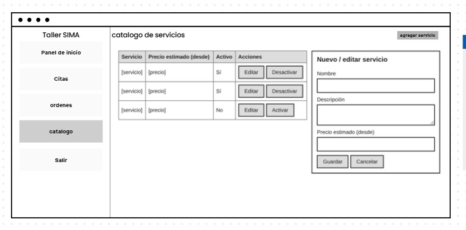
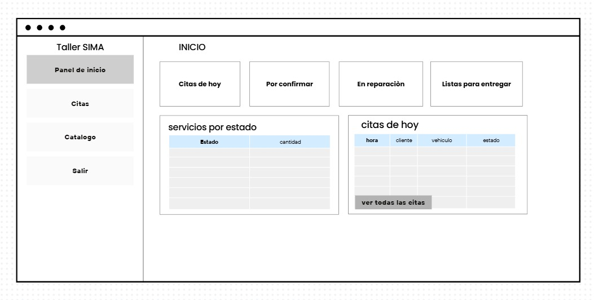

# Nombre del proyecto: 
SIMA

# Equipo :
-Aviles Cruz Oswaldo Said
-Chi Rodríguez Karla Jhoana
-Chim Balam Edgar Joaquin
-Rocha Vajello Jessica

# Problema: 
El problema principal es que no tienen un registro formal de los vehículos que entran Actualmente, todo lo anotan en libretas. Esta situacion afecta a todos ya que causa errores de organizacion, perdida de informacion y mucha confucion al momento de saber que reparacion o servicio se le hizo a cada automovil

# Flujo Seleccionado: 
1.- El cliente consulta el catálogo desde el móvil.
2.- El cliente solicita una cita y envía datos de su vehiculo.
3.- La API valida la solicitud y guarda.
4.- El encargado en el taller ve la cita en la aplicación web y la confirma, el cliente ve la confirmación en su móvil.
5.- El vehículo llega al taller y el encargado crea la orden de trabajo.
6.- Se registra el diagnóstico y la cotización.
7.- El cliente revisa la cotización en el móvil y la autoriza.
8.- El taller actualiza el estado de reparación y el cliente puede verlo en su móvil.
9.- Al entregar el vehiculo la orden se cierra y se guarda en el historial.

# Mapa de navegacion:

# Bocetos:
 
 
 

 

#Capturas del proyecto:

# Tecnologías utilizadas:
- Frontend: React + TypeScript
- Herramienta de construcción: Vite
- Linter: Oxlint
- Control de versiones: Git y GitHub

# Estructura del proyecto:
SIMA/
├── public/              
├── src/
│   ├── assets/          
│   ├── components/      
│   ├── App.tsx          
│   └── main.tsx         
├── package.json         
├── tsconfig.json        
└── vite.config.ts      